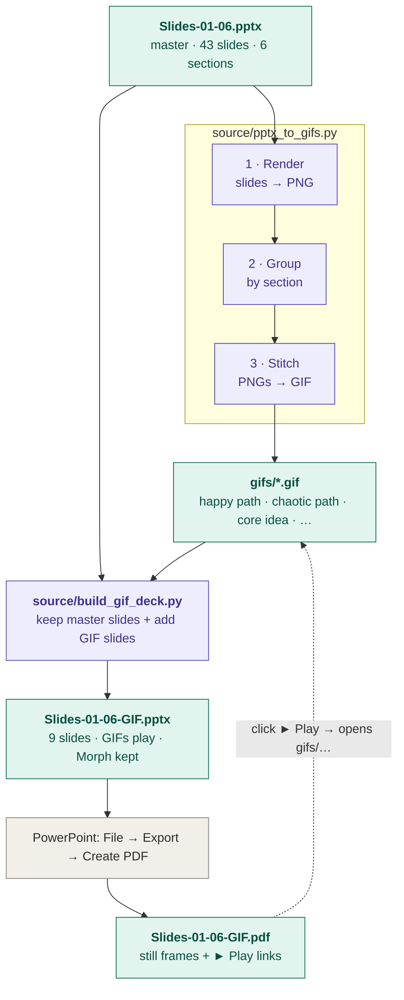

# Multi-Agent Systems & Subgraph Architecture

Team deck, built in parts. Each folder is one block of slides from the deck structure.

| Folder | Slides | Status |
|---|---|---|
| `slides-01-06/` | 1 Title · 2 Why Single Agents Fail · 3 Part 2 (thinking + acting + checking) · 4 Failure Modes · 5 Root Cause · 6 Core Idea | 🔒 Locked |
| `slides-14-16/` | 14 Common Mistakes · 15 How to Choose the Right Pattern · 16 Design Principles · 16a LangChain and LangGraph | ✏️ Draft (animations later) |

```
multi-agent-deck/
├── slides-01-06/
│   ├── Slides-01-06.pptx          ← master: 43 slides, Morph — present this live
│   ├── Slides-01-06-GIF.pptx      ← short version: 9 slides, GIFs + Morph
│   ├── Slides-01-06-GIF.pdf       ← PDF export (keep gifs/ next to it)
│   ├── gifs/                      ← one GIF per animation
│   ├── SPEAKER_NOTES.md
│   └── source/                    ← scripts + data to rebuild (see below)
└── slides-14-16/
    ├── Slides-14-16.pptx          ← 4 slides
    ├── SPEAKER_NOTES.md
    └── source/build_slides.js
```

## Slides 1–6: master → GIFs → short deck → PDF



*Purple: script you run · Teal: file · Grey: manual step.*

```bash
cd slides-01-06/source
pip install pillow numpy python-pptx pymupdf     # + LibreOffice, or on Windows: pip install pywin32
python pptx_to_gifs.py                           # → ../gifs/
python build_gif_deck.py                         # → ../Slides-01-06-GIF.pptx
```
Then open `Slides-01-06-GIF.pptx` → File → Export → Create PDF/XPS (not *Print to PDF*, which drops links). Share the PDF together with its `gifs` folder.

Rebuilding the master itself (only if the content changes): `node build_deck.js && python add_morph.py && python apply_notes.py` (needs `npm install pptxgenjs react react-dom react-icons sharp`).

## Slides 14–16

```bash
cd slides-14-16/source
node build_slides.js                             # → ../Slides-14-16.pptx (notes from ../SPEAKER_NOTES.md)
```

## Design system

White background; light fill + darker outline + darkest text from one colour family. Purple = control/thinking, teal = agents/acting/fixes, coral = checking/mistakes, grey = neutral. Full palette in `slides-01-06/source/LOCKED.md`.
