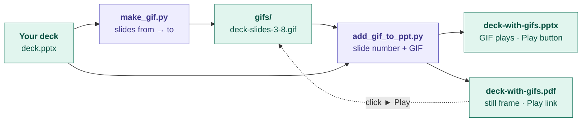

# GIF Builder

Two small Python tools that work on **any** PowerPoint:

1. **`make_gif.py`**: slides *from → to* of a deck become one animated GIF.
2. **`add_gif_to_ppt.py`**: a GIF goes onto a slide with a **► Play animation** button, ready to export as PDF.

Both scripts ask their questions in the terminal, so they're easy to demo. No VBA or macros: `python-pptx` edits the `.pptx` file directly.

---

## The whole process



The same thing in blocks:

```
┌──────────────────────┐   ┌──────────────────────┐   ┌──────────────────────┐   ┌──────────────────────┐
│ BLOCK 1 · SET UP     │ → │ BLOCK 2 · MAKE GIF   │ → │ BLOCK 3 · ADD TO PPT │ → │ BLOCK 4 · SHARE      │
│ install once         │   │ make_gif.py          │   │ add_gif_to_ppt.py    │   │ PPT + PDF + gifs/    │
│                      │   │ PPT + slides a→b     │   │ PPT + slide + GIF    │   │ in one folder / zip  │
│                      │   │ → gifs/*.gif         │   │ → *-with-gifs.pptx   │   │                      │
│                      │   │                      │   │ → *-with-gifs.pdf    │   │                      │
└──────────────────────┘   └──────────────────────┘   └──────────────────────┘   └──────────────────────┘
```

---

## Block 1 · Set up (once)

```bash
cd gif-builder
pip install -r requirements.txt        # pillow, numpy, python-pptx, pymupdf (+ pywin32 on Windows)
```

Plus **one** way to render slides and export PDFs:

| You have | Install | Notes |
|---|---|---|
| Windows + PowerPoint | `pip install pywin32` | Best: PowerPoint renders the slides itself, so fonts match exactly |
| Any OS | [LibreOffice](https://www.libreoffice.org/) | Used automatically when PowerPoint isn't available |

---

## Block 2 · Make a GIF from slides

```bash
python make_gif.py
```

| It asks | You answer | Example |
|---|---|---|
| 1) PowerPoint file | path to the deck (drag it in, or paste "Copy as path") | `C:\decks\Agents.pptx` |
| 2) First slide / Last slide | the range to animate | `34` … `39` |
| 3) Save the GIF in folder | Enter = `gifs` next to the deck | |
| File name | Enter = `<deck>-slides-34-39.gif` | |

**What happens inside**
1. **Render:** each slide in the range becomes a PNG (PowerPoint, or LibreOffice).
2. **Stitch:** the PNGs are joined into a looping GIF: each slide is held about 1.3 s, with a short cross-fade between slides, and the last slide stays longest.
3. **Save:** the GIF lands in the `gifs` folder. Exact colours and pure white background, so it blends into a white slide.

Skip the questions when you already know the answers:

```bash
python make_gif.py --pptx Agents.pptx --from 34 --to 39 --crop-top 1.4 --crop-bottom 0.55
```

`--crop-top` / `--crop-bottom` cut inches off each slide, e.g. to remove the title and footer when the GIF goes on a slide that already has them. `--hold 1000` makes it faster.

---

## Block 3 · Put the GIF on a slide (+ Play button)

```bash
python add_gif_to_ppt.py
```

| It asks | You answer |
|---|---|
| 1) PowerPoint file | the deck to add the GIF to |
| Save the result as | Enter = `<deck>-with-gifs.pptx` (the original is never changed) |
| 2) Put the GIF on slide | slide number, e.g. `3` |
| 3) GIF file, or a folder of GIFs | a `.gif`, or a folder; it then lists the GIFs to pick from |
| 4) [1] on that slide · [2] on a new slide after it | `1` adds it on top of the slide; `2` inserts a clean new slide |
| Add another GIF? | `y` to repeat steps 2–4 for more slides |
| 5) Export a PDF too? | `y` saves `<deck>-with-gifs.pdf` next to it |

**What happens inside**
1. The GIF is **copied into `gifs/` next to the saved PowerPoint**, so the link always works.
2. The GIF is placed, fitted to the slide and centred. It plays by itself in PowerPoint.
3. A **► Play animation** button goes under it. Its text links to `gifs/<file>.gif`.
4. Optional PDF export (PowerPoint via `pywin32`, or LibreOffice), then the links are fixed automatically (see Block 4).

After it runs, open the PowerPoint to adjust. The GIF and the button are normal shapes, so move, resize or recolour them as you like. Find them by name in **Home → Arrange → Selection Pane**: `GIF <file>` and `Play button <file>`.

Without questions:

```bash
python add_gif_to_ppt.py --pptx Agents.pptx --slide 3 --gif gifs/Agents-slides-34-39.gif --pdf
python add_gif_to_ppt.py --pptx Agents.pptx --slide 3 --gif gifs/demo.gif --new-slide
```

**Doing the link by hand instead** (e.g. on a button you drew yourself): select the button's text → **Ctrl+K** → *Existing File or Web Page* → type `gifs/<file>.gif` in **Address** (type it; *Browse* saves a full `C:\…` path that breaks on other machines).

---

## Block 4 · Share it

Keep these together in one folder (or one zip):

```
Agents-with-gifs.pptx      ← GIFs play inside PowerPoint (they're stored in the file)
Agents-with-gifs.pdf       ← still frames; ► Play opens the GIF
gifs/                      ← must sit next to the PDF/PPTX, names unchanged
```

| Where it's opened | GIF | ► Play link |
|---|---|---|
| PowerPoint | plays by itself | opens the GIF |
| PDF in Adobe Acrobat | first frame | opens the GIF (may ask permission) |
| PDF in Edge / Chrome | first frame | may be blocked for local files |

For a PDF that works anywhere, put the GIFs on SharePoint or OneDrive and use those web addresses as the links (Ctrl+K → Address).

**Easiest: one command, PPT in → working PDF out**

```bash
python ppt_to_pdf.py                 # asks: PowerPoint file (path)
```

It exports the PDF next to the PPT, fixes the GIF links, and lists each Play link with `found` / `MISSING` so you know the `gifs` folder is complete. It doesn't add or move anything: the buttons and their links were already set by `add_gif_to_ppt.py` (or by hand with Ctrl+K).

| Script | Asks for | Decides |
|---|---|---|
| `make_gif.py` | PPT + slide range | which slides become the GIF |
| `add_gif_to_ppt.py` | PPT + slide + GIF | **where the GIF and ► Play button go, and the link** |
| `ppt_to_pdf.py` | PPT | nothing: exports + fixes links |
| `fix_pdf_links.py` | PDF | nothing: fixes links in a PDF you exported yourself |

**Exported the PDF yourself from PowerPoint? Run the fixer afterwards:**

```bash
python fix_pdf_links.py Agents-with-gifs.pdf
```

PowerPoint's *File → Export → PDF* rewrites links to local files, either as a full `C:\Users\…` path or as a "launch this file" action. Edge blocks launch actions, and full paths break on any other computer, so **► Play** does nothing. `fix_pdf_links.py` turns every GIF link back into a plain `gifs/<file>.gif` link (it keeps the original as `.orig.pdf`). For links that work from anywhere, point them at SharePoint/OneDrive instead:

```bash
python fix_pdf_links.py Agents-with-gifs.pdf --base https://yourcompany.sharepoint.com/sites/team/Shared%20Documents/gifs/
```

```
┌──────────────────────┐   ┌──────────────────────────┐   ┌──────────────────────┐
│ PowerPoint           │ → │ fix_pdf_links.py         │ → │ PDF: ► Play works    │
│ File → Export → PDF  │   │ C:\…\x.gif / Launch      │   │ (gifs/ next to it)   │
│                      │   │      → gifs/x.gif        │   │                      │
└──────────────────────┘   └──────────────────────────┘   └──────────────────────┘
```

Use *File → Export → Create PDF/XPS* (or Save As → PDF). *Print → Microsoft Print to PDF* drops every link, so there is nothing left to fix.

---

## Troubleshooting

| Message | Fix |
|---|---|
| `Could not render slides` | Install `pywin32` (Windows + PowerPoint) or LibreOffice |
| `No module named 'pptx'` / `'pymupdf'` | `pip install python-pptx pymupdf` |
| `Slide range must be within 1–N` | Use slide numbers that exist in the deck |
| `PermissionError` when saving | The file is open in PowerPoint; close it and run again |
| GIF looks soft | Raise `GIF_WIDTH` at the top of `make_gif.py` (bigger file) |
| GIF too fast or slow | `--hold 900` (faster) or `--hold 2000` (slower) |
| ► Play does nothing in a PDF you exported from PowerPoint | `python fix_pdf_links.py <file>.pdf`, and keep `gifs/` next to the PDF |
| `No links to .gif files found` | The PDF was made with *Print to PDF*; re-export with *File → Export* |
